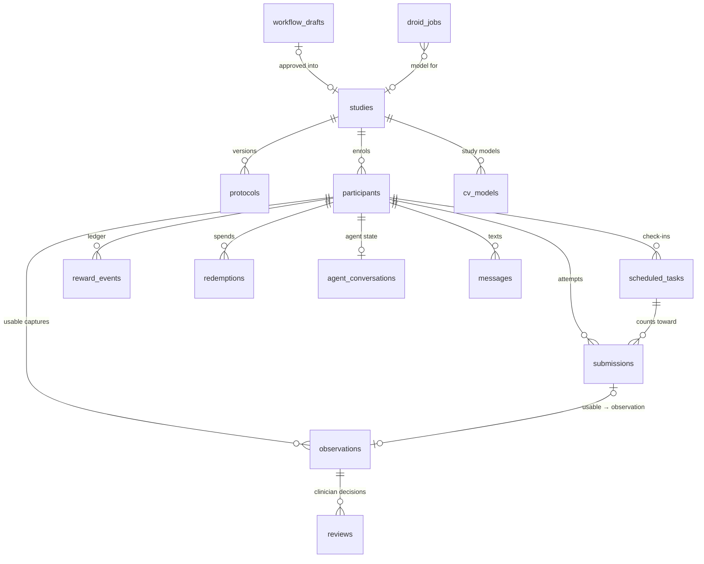

# Database design (Supabase Postgres + Storage)

Every service persists to one Supabase project:

| Service | Talks to the database | Writes |
|---|---|---|
| **Web app** (`apps/web`, Vercel) | directly, with the service role key (server code only: `lib/backend.ts`) | captures (via `record_capture`), reviews, participants and invites, rewards, models, builder drafts and studies, Droid jobs, audit log, media uploads |
| **Messaging agent** (`services/agent`) | directly, with the service role key (`src/supabaseStore.ts`); an agent without database access can instead use the web app's `/api/agent/roster` (participants, protocols, reminders) and `/api/agent/events` (audit events), guarded by `AGENT_INTERNAL_SECRET` | conversations, messages, check-in prompting and escalation, inbound attachments in Storage. Captures go to the web app's `/api/cv-callback`, so there is one ingest path and one reward ledger |
| **CV service** (`services/cv`) | never | stateless: reads media from the signed URLs it is given and returns an `Observation`; the caller records it |

Browsers never talk to the database. Row-level security is on for every table, no policy grants the `anon` role anything, and the `media` bucket is private (only signed URLs). The one browser-side Supabase call is uploading a large video to a **signed upload URL** the server created for that participant.

Without Supabase configured, the web app and agent fall back to in-memory demo data with the same behaviour (`apps/web/lib/demo-data.ts`).

## How the app chooses demo vs Supabase

`apps/web/lib/backend.ts` is the single persistence layer. On boot:

1. If `NEXT_PUBLIC_SUPABASE_URL` **and** `SUPABASE_SERVICE_ROLE_KEY` are set → **Supabase mode** (Postgres + Storage).
2. Otherwise → **demo mode**: the same API surface backed by `apps/web/lib/demo-data.ts` (in memory; lost on restart).

The messaging agent mirrors this (`services/agent` → `supabaseStore.ts`). Browsers never hold the service role key; they only upload large videos through signed URLs the server mints.

Without Supabase you can still run the full demo (studies, captures, module generation). Generated models and Droid jobs land in the in-memory registry until you point the app at a real project.

## Set up a project (Supabase dashboard)

1. Create a project at [supabase.com](https://supabase.com) (free tier is fine).
2. Open **SQL → New query**. Paste the entire contents of [`supabase/setup.sql`](../supabase/setup.sql) and **Run**. That applies every migration (through `0006_model_source.sql`) plus the core seed and creates the private `media` bucket.
3. If this project was set up earlier with the synthetic demo history, paste and run [`supabase/cleanup_synthetic.sql`](../supabase/cleanup_synthetic.sql) once: it removes the generated participants, check-ins and observations and keeps every real upload. Safe to run twice.
4. **Project Settings → API** — copy into the **repo-root** `.env.local` (same file as Factory/Daytona keys). Restart `npm run dev` after saving.

```bash
NEXT_PUBLIC_SUPABASE_URL=https://YOUR_PROJECT.supabase.co
NEXT_PUBLIC_SUPABASE_ANON_KEY=eyJ...          # browser signed uploads only
SUPABASE_SERVICE_ROLE_KEY=eyJ...             # server only — never commit / never expose to the browser
```

| Variable | Web app (Vercel / local) | Agent |
|---|---|---|
| `NEXT_PUBLIC_SUPABASE_URL` | ✓ | ✓ (or `SUPABASE_URL`) |
| `NEXT_PUBLIC_SUPABASE_ANON_KEY` | ✓ (signed uploads only) | |
| `SUPABASE_SERVICE_ROLE_KEY` | ✓ (server only) | ✓ |

5. Verify from the repo root:

```bash
export $(grep -E '^(NEXT_PUBLIC_SUPABASE_|SUPABASE_SERVICE)' .env.local | xargs)
node supabase/smoke.mjs
```

You should see `ok` for every table, `record_capture`, a private `media` bucket, and anon unable to read participants. In the app, **Researcher → Settings** (system status) shows the same table counts and bucket check; the researcher chrome stops showing “demo” once Supabase mode is active.

With the Supabase CLI instead: `supabase link`, then `supabase db push` (migrations) and `psql "$DATABASE_URL" -f supabase/seed.sql`.

## Entity relationships



## Tables

Ids are text so records keep readable, stable ids across the demo seed, the app and the agent (`p_001`, `obs_…`, `sub_…`); a few internal tables use generated uuids.

### Study design

| Table | Purpose | Key columns | Written by |
|---|---|---|---|
| `studies` | A study and its condition. Builder-approved studies start as `draft`; the New study form creates `active` ones. | `id`, `condition`, `status` (draft/active/closed) | seed, web (New study form, builder approve) |
| `protocols` | Versioned protocol: tasks, capture instructions, quality criteria, measurements, rewards, consent form and reminder schedule (`config` = zod `Protocol`). The latest version is used. | unique (`study_id`, `version`) | seed, web (New study form, builder approve) |
| `workflow_drafts` | Condition-builder drafts (`draft` = zod `WorkflowDraft`), kept until a clinician approves one into a study. | `status` (draft/approved/discarded), `study_id` | web |
| `cv_models` | Previously registered trained ridge heads; Droid candidate generation does not insert rows. | `module`, `study_id` (null = all studies), `active`, `status`, `provenance`, `source_code`, `module_params` | web |
| `droid_jobs` | In-process Droid+Daytona generation jobs. | `id`, `status`, `progress` (steps, logs, experiments), `kind` (`module_generate`) | web |
| `researchers`, `study_members` | Researcher accounts and study roles, for Supabase Auth (not used yet: sign-in is planned). | | |

### Participants and collection

| Table | Purpose | Key columns | Written by |
|---|---|---|---|
| `participants` | Enrolment, contact and reminder preferences. | unique `phone` (the agent's address), unique upper-case `invite_code`, `status`, `consented_at`, `preferred_time`, `timezone` | seed, web (invite, join) |
| `scheduled_tasks` | Check-ins: one per protocol task per period. | unique (`participant_id`, `task_id`, `due_at`), `status` (pending → prompted → completed / missed / escalated), `window_hours` | web (enrolment, each capture), agent (scheduler) |
| `submissions` | Every capture attempt, usable or not, from either channel. | `scheduled_task_id`, `attempt`, `source` (web/sms), `analysis_runtime` (on-device/server), `quality`, `accepted`, `escalated`, `observation_id`, `media_url` | `record_capture` |
| `observations` | The common observation format: one per usable capture, waiting for clinician review. The first measurement is the rule-based 0–4 `severity_score` (`packages/shared/src/scores.ts`; what drove it is in `context.score_basis`). | `measurements`, `features`, `quality`, `patient_report`, `context` (e.g. `trim_start_s`), `model_version`, `review_status` | `record_capture`; review updates |
| `reviews` | Every clinician decision, including the values a correction replaced. The observation holds the latest decision. | `decision`, `corrected_measurements`, `before_measurements`, `reviewer`, `note` | web |
| `reward_events` | Simulated points ledger; the balance is the sum. Redemptions are negative entries. | id `<submission>:<kind>:<n>` (so a retried capture can't award twice) | `record_capture`, web (redeem) |
| `redemptions` | Simulated payouts with a mock code. No money moves. | `tier`, `points`, `mock_code` | web |

### Messaging agent

| Table | Purpose | Key columns | Written by |
|---|---|---|---|
| `agent_conversations` | Conversation state per participant (`state` = the agent's `ConvState`, the check-in it's about, last prompts). | `participant_id` (PK), `address`, `last_prompted_at` | agent |
| `messages` | Every inbound and outbound text, with attachment paths; shown on the researcher's participant page. | `direction`, `body`, `media_path`, `scheduled_task_id`, `submission_id` | agent |

### Governance

| Table | Purpose | Written by |
|---|---|---|
| `audit_log` | Append-only trail: captures, reviews, invites, enrolment, model changes, protocol approvals, Droid requests, escalations, redemptions. | web, agent |

## Functions

**`record_capture(payload jsonb)`** records one capture in a single transaction: the submission, the observation (if usable), reward events, the check-in it closes (completed or escalated), the next check-in and an audit row. `apps/web/lib/ingest.ts` makes every decision (acceptance, models, rewards, the next due date) and passes the result. Every insert ignores existing rows, so a retried request can't award points twice or reset an observation a clinician already reviewed. Only the service role may call it.

**Scheduling** lives in TypeScript (`packages/shared/src/schedule.ts`) and is shared by the web app and the agent. Each protocol task has one open check-in at a time. The next one is due one cadence period after the last, skipping periods that are already over. Expired check-ins become `missed`. A new participant's first check-in is due at enrolment. The unique (`participant_id`, `task_id`, `due_at`) constraint makes scheduling safe to repeat from both services.

## Storage

| Bucket | Access | Limits | Layout |
|---|---|---|---|
| `media` | private: service role and signed URLs only | 50 MB, `image/*` and `video/*` | `studies/<study>/<participant>/<yyyy-mm>/<uuid>.<ext>` (older web uploads: `uploads/<yyyy-mm>/…`) |

- Web uploads go through the API (small files), or straight to Storage via a signed upload URL scoped to the participant's folder (large videos). The API only accepts a `media_path` inside that participant's folder.
- The agent uploads inbound attachments itself, then gives the CV service a one-hour signed URL.
- Rows store `/api/media/s/<path>`. The web app turns that into a 10-minute signed URL each time it is viewed, so links in the database never expire or leak.

## Row-level security

RLS is enabled on every table. The policies in `0001_init.sql` are for the planned Supabase Auth sign-in: study members read their studies' data, and participants read their own rows. Nothing grants the `anon` role access, and the server-only tables (`agent_conversations`, `workflow_drafts`, `droid_jobs`, `messages`) have no policies at all. All current access is server-side with the service role.

## Tests

`supabase/test/run.sh` applies `setup.sql` to a throwaway Postgres (or `DATABASE_URL`, an empty database) and runs `supabase/test/tests.sql`:
- `record_capture` semantics and idempotency;
- escalation;
- constraints;
- that `anon` and signed-in strangers see nothing;
- the bucket settings.

CI runs it on every push. The seeds and this document are generated, and `npm test` fails if any is stale:
- `npx tsx apps/web/scripts/make-seed.ts` regenerates the seeds;
- `node supabase/make-setup.mjs` regenerates `setup.sql` and this SQL appendix.

## SQL (all migrations, in order)

<!-- BEGIN GENERATED SQL: node supabase/make-setup.mjs -->

### `supabase/migrations/0001_init.sql`

```sql
-- Visual Follow-Up Platform: initial schema.
-- Observation columns mirror packages/shared/src/schemas.ts (PRD §4 common format).

-- gen_random_uuid() is built into Postgres 13+ (Supabase runs 15), so no extension is needed.

-- ---------- people ----------
create table researchers (
  id uuid primary key references auth.users (id) on delete cascade,
  name text not null,
  institution text,
  created_at timestamptz not null default now()
);

create table studies (
  id text primary key,
  name text not null,
  condition text not null,                  -- 'parkinsons' | 'eczema' | ...
  owner_id uuid references researchers (id),
  status text not null default 'active' check (status in ('draft', 'active', 'closed')),
  created_at timestamptz not null default now()
);

create table study_members (
  study_id text references studies (id) on delete cascade,
  researcher_id uuid references researchers (id) on delete cascade,
  role text not null default 'investigator' check (role in ('investigator', 'coordinator', 'reviewer')),
  primary key (study_id, researcher_id)
);

-- Versioned protocol: tasks (module configs) + reward rules as JSON validated by the shared zod schema.
create table protocols (
  id uuid primary key default gen_random_uuid(),
  study_id text not null references studies (id) on delete cascade,
  version int not null,
  config jsonb not null,
  approved_by uuid references researchers (id),
  approved_at timestamptz,
  created_at timestamptz not null default now(),
  unique (study_id, version)
);

create table participants (
  id text primary key,
  study_id text not null references studies (id) on delete cascade,
  user_id uuid unique references auth.users (id) on delete set null,   -- set when they create an account
  display_name text not null,
  phone text unique,                        -- Photon address
  invite_code text unique not null,
  preferred_time time,
  timezone text default 'America/New_York',
  consented_at timestamptz,
  status text not null default 'invited' check (status in ('invited', 'active', 'paused', 'withdrawn', 'completed')),
  enrolled_at timestamptz,
  created_at timestamptz not null default now()
);

-- ---------- collection ----------
create table scheduled_tasks (
  id uuid primary key default gen_random_uuid(),
  participant_id text not null references participants (id) on delete cascade,
  task_id text not null,                    -- TaskConfig.id within the protocol
  due_at timestamptz not null,
  window_hours int not null default 48,
  status text not null default 'pending' check (status in ('pending', 'prompted', 'completed', 'missed', 'escalated')),
  prompted_at timestamptz,
  completed_at timestamptz
);
create index on scheduled_tasks (status, due_at);

create table submissions (
  id text primary key,
  participant_id text not null references participants (id) on delete cascade,
  scheduled_task_id uuid references scheduled_tasks (id),
  task_id text not null,
  attempt int not null default 1,
  media_path text,                          -- Supabase Storage path in the 'media' bucket
  quality jsonb,                            -- QualityReport
  accepted boolean,
  created_at timestamptz not null default now()
);

create table observations (
  id text primary key,
  study_id text not null references studies (id) on delete cascade,
  participant_id text not null references participants (id) on delete cascade,
  submission_id text not null,
  module text not null,
  task_label text not null,
  captured_at timestamptz not null,
  media_url text,
  quality jsonb not null,
  measurements jsonb not null,              -- Measurement[] with value, unit, uncertainty, validation_status
  model_version text not null,
  patient_report jsonb not null default '{}',
  context jsonb not null default '{}',
  review_status text not null default 'pending' check (review_status in ('pending', 'accepted', 'corrected', 'rejected')),
  reviewer text,
  reviewed_at timestamptz,
  review_note text,
  created_at timestamptz not null default now()
);
create index on observations (participant_id, captured_at);
create index on observations (study_id, review_status);

-- Every clinician decision, including corrections to individual measurements.
create table reviews (
  id uuid primary key default gen_random_uuid(),
  observation_id text not null references observations (id) on delete cascade,
  reviewer_id uuid references researchers (id),
  decision text not null check (decision in ('accepted', 'corrected', 'rejected')),
  corrected_measurements jsonb,
  note text,
  created_at timestamptz not null default now()
);

create table messages (
  id uuid primary key default gen_random_uuid(),
  participant_id text references participants (id) on delete cascade,
  direction text not null check (direction in ('inbound', 'outbound')),
  channel text not null default 'photon',
  body text,
  media_path text,
  created_at timestamptz not null default now()
);

-- ---------- rewards (simulated) ----------
create table reward_events (
  id text primary key,
  participant_id text not null references participants (id) on delete cascade,
  kind text not null check (kind in ('submission_accepted', 'on_time_bonus', 'streak_bonus', 'badge', 'redemption')),
  points int not null,
  reason text not null,
  created_at timestamptz not null default now()
);
create index on reward_events (participant_id);

create table redemptions (
  id text primary key,
  participant_id text not null references participants (id) on delete cascade,
  tier text not null,
  points int not null,
  payout_label text not null,
  mock_code text not null,                  -- simulated; no real payment is issued
  created_at timestamptz not null default now()
);

-- ---------- audit ----------
create table audit_log (
  id bigint generated always as identity primary key,
  actor text not null,                      -- 'agent', 'cv', researcher id, participant id
  action text not null,
  entity text not null,
  entity_id text,
  detail jsonb,
  created_at timestamptz not null default now()
);

-- ---------- row level security ----------
-- Server code (agent, API routes) uses the service role key and bypasses RLS.
alter table researchers enable row level security;
alter table studies enable row level security;
alter table study_members enable row level security;
alter table protocols enable row level security;
alter table participants enable row level security;
alter table scheduled_tasks enable row level security;
alter table submissions enable row level security;
alter table observations enable row level security;
alter table reviews enable row level security;
alter table messages enable row level security;
alter table reward_events enable row level security;
alter table redemptions enable row level security;
alter table audit_log enable row level security;

create function is_study_member(sid text) returns boolean
language sql stable security definer set search_path = public as $$
  select exists (select 1 from study_members where study_id = sid and researcher_id = auth.uid())
      or exists (select 1 from studies where id = sid and owner_id = auth.uid());
$$;

create function my_participant_id() returns text
language sql stable security definer set search_path = public as $$
  select id from participants where user_id = auth.uid();
$$;

create policy "self" on researchers for all using (id = auth.uid());
create policy "members read studies" on studies for select using (is_study_member(id));
create policy "members read membership" on study_members for select using (is_study_member(study_id));
create policy "members read protocols" on protocols for select using (is_study_member(study_id));
create policy "members manage participants" on participants for all using (is_study_member(study_id));
create policy "participant reads self" on participants for select using (user_id = auth.uid());
create policy "members read observations" on observations for select using (is_study_member(study_id));
create policy "members review observations" on observations for update using (is_study_member(study_id));
create policy "participant reads own observations" on observations for select using (participant_id = my_participant_id());
create policy "members read reviews" on reviews for select using (
  exists (select 1 from observations o where o.id = observation_id and is_study_member(o.study_id)));
create policy "participant reads own rewards" on reward_events for select using (participant_id = my_participant_id());
create policy "participant reads own redemptions" on redemptions for select using (participant_id = my_participant_id());
create policy "participant reads own tasks" on scheduled_tasks for select using (participant_id = my_participant_id());

-- Media bucket (private; access through signed URLs).
insert into storage.buckets (id, name, public) values ('media', 'media', false) on conflict do nothing;
```

### `supabase/migrations/0002_ingest_and_models.sql`

```sql
-- Web uploads, on-device analysis, researcher-trained models.
-- Columns mirror packages/shared/src/schemas.ts (Observation.features, Submission, CvModel).

-- numeric feature vector from the CV module, read by researcher-trained models
alter table observations add column features jsonb not null default '{}';

-- every capture attempt, usable or not, from either channel
alter table submissions
  add column study_id text references studies (id) on delete cascade,
  add column source text not null default 'sms' check (source in ('web', 'sms')),
  add column media_type text check (media_type in ('photo', 'video')),
  add column media_url text,
  add column analysis_runtime text not null default 'server' check (analysis_runtime in ('on-device', 'server')),
  add column observation_id text references observations (id) on delete set null,
  add column escalated boolean not null default false;
-- task ids are opaque strings in the app; drop the uuid FK before widening the column
alter table submissions drop constraint if exists submissions_scheduled_task_id_fkey;
alter table submissions alter column scheduled_task_id type text using scheduled_task_id::text;
create index on submissions (participant_id, created_at);
create index on submissions (study_id, created_at);

-- scheduled tasks can end in an escalation (three unusable attempts)
alter table scheduled_tasks drop constraint if exists scheduled_tasks_status_check;
alter table scheduled_tasks add constraint scheduled_tasks_status_check
  check (status in ('pending', 'prompted', 'completed', 'missed', 'escalated'));

-- ridge-regression heads trained in the researcher toolkit
create table cv_models (
  id text primary key,
  name text not null,
  description text not null default '',
  study_id text references studies (id) on delete cascade,   -- null = every study using the module
  module text not null,
  target jsonb not null,                                      -- { name, label, unit }
  kind text not null default 'ridge' check (kind in ('ridge')),
  features jsonb not null,                                    -- feature names, in weight order
  weights jsonb not null,
  intercept double precision not null,
  feature_means jsonb not null,
  feature_stds jsonb not null,
  lambda double precision not null,
  metrics jsonb not null,                                     -- n, folds, mae, rmse, r, baseline_mae, label_min, label_max
  status text not null default 'reusable_needs_validation'
    check (status in ('validated', 'reusable_needs_validation', 'new_model_required')),
  active boolean not null default true,
  version int not null default 1,
  created_by text not null,
  created_at timestamptz not null default now()
);
create index on cv_models (module, active);

alter table cv_models enable row level security;
create policy "members read models" on cv_models for select using (study_id is null or is_study_member(study_id));
create policy "members read submissions" on submissions for select using (is_study_member(study_id));
create policy "participant reads own submissions" on submissions for select using (participant_id = my_participant_id());
create policy "members read audit" on audit_log for select using (
  exists (select 1 from study_members m where m.researcher_id = auth.uid()));
```

### `supabase/migrations/0003_model_provenance.sql`

```sql
-- Models trained outside the browser (training kit, or Droid in GitHub Actions) record their
-- dataset, licence, label source and evaluation summary. Bundled models are served from the
-- web app's code; a row only appears here once someone changes one (e.g. deactivates it).
alter table cv_models add column provenance jsonb;
```

### `supabase/migrations/0004_backends.sql`

```sql
-- Every backend persists here: the web app (uploads, reviews, builder, Droid), the messaging
-- agent (conversations, messages, scheduling) and, through the web app's ingest path, the CV
-- service's analyses. Server code uses the service role key; nothing is reachable from a browser.

-- ---------- scheduling ----------
-- ids are opaque strings in the app (seeded ids like 'st_p_001_0'); generated ones stay uuids
alter table scheduled_tasks alter column id drop default;
alter table scheduled_tasks alter column id type text using id::text;
alter table scheduled_tasks alter column id set default gen_random_uuid()::text;
-- one check-in per task per due time, so scheduling is safe to repeat
alter table scheduled_tasks add constraint scheduled_tasks_once unique (participant_id, task_id, due_at);
create index on scheduled_tasks (participant_id, due_at);
alter table submissions add constraint submissions_scheduled_task_fkey
  foreign key (scheduled_task_id) references scheduled_tasks (id) on delete set null;

-- invite codes are typed by people: stored upper-case so a typed code matches exactly
update participants set invite_code = upper(invite_code) where invite_code <> upper(invite_code);
alter table participants add constraint participants_invite_code_upper check (invite_code = upper(invite_code));

create index on observations (submission_id);
create index on observations (study_id, captured_at);
create index on submissions (observation_id);
create index on audit_log (entity_id);
create index on audit_log (created_at);

-- ---------- reviews ----------
-- reviewers are named in the app (no sign-in yet), so record the name rather than an auth id
alter table reviews drop column reviewer_id;
alter table reviews add column reviewer text not null default 'unknown';
alter table reviews add column before_measurements jsonb;
create index on reviews (observation_id, created_at);

-- ---------- messaging agent ----------
create table agent_conversations (
  participant_id text primary key references participants (id) on delete cascade,
  channel text not null default 'photon',
  address text not null,                    -- phone number or handle the agent talks to
  state jsonb not null,                     -- services/agent ConvState
  last_prompted_at timestamptz,
  updated_at timestamptz not null default now()
);
create index on agent_conversations (address);

alter table messages
  add column scheduled_task_id text references scheduled_tasks (id) on delete set null,
  add column submission_id text references submissions (id) on delete set null,
  add column meta jsonb not null default '{}';
create index on messages (participant_id, created_at);

-- ---------- researcher toolkit ----------
-- condition builder drafts; approving one creates a study (status 'draft') and protocol v1
create table workflow_drafts (
  id text primary key,
  condition text not null,
  draft jsonb not null,                     -- WorkflowDraft
  source text not null check (source in ('claude', 'template')),
  status text not null default 'draft' check (status in ('draft', 'approved', 'discarded')),
  study_id text references studies (id) on delete set null,
  created_by text not null,
  approved_by text,
  approved_at timestamptz,
  created_at timestamptz not null default now()
);

-- "Generate with Droid": one row per request, updated from the GitHub Actions run
create table droid_jobs (
  id text primary key,
  study_id text references studies (id) on delete set null,
  module text not null,
  request jsonb not null,
  status text not null default 'requested' check (status in ('requested', 'dispatched', 'running', 'succeeded', 'failed')),
  run_id bigint,
  run_url text,
  pr_url text,
  error text,
  created_by text not null,
  created_at timestamptz not null default now(),
  updated_at timestamptz not null default now()
);
create index on droid_jobs (created_at);

create function touch_updated_at() returns trigger language plpgsql as $$
begin
  new.updated_at := now();
  return new;
end $$;
create trigger touch before update on agent_conversations for each row execute function touch_updated_at();
create trigger touch before update on droid_jobs for each row execute function touch_updated_at();

alter table agent_conversations enable row level security;
alter table workflow_drafts enable row level security;
alter table droid_jobs enable row level security;
-- (no policies: server-only, through the service role)

-- ---------- one capture, one transaction ----------
-- The web app's ingest (lib/ingest.ts) decides everything (acceptance, rewards, the next
-- check-in) and hands the result here, so a capture is recorded completely or not at all.
-- Safe to repeat: every insert ignores rows that already exist, so a retried request can't
-- duplicate points or reset a reviewed observation.
create function record_capture(payload jsonb) returns jsonb
language plpgsql security definer set search_path = public as $$
declare
  s jsonb := payload -> 'submission';
  o jsonb := payload -> 'observation';
  t jsonb := payload -> 'scheduled_task';
  n jsonb := payload -> 'next_task';
  a jsonb := payload -> 'audit';
  obs_inserted boolean := false;
  task_updated boolean := false;
  rewards_inserted int := 0;
begin
  if o is not null and o <> 'null'::jsonb then
    insert into observations (id, study_id, participant_id, submission_id, module, task_label, captured_at, media_url,
      quality, measurements, features, model_version, patient_report, context, review_status)
    values (o->>'id', o->>'study_id', o->>'participant_id', o->>'submission_id', o->>'module', o->>'task_label',
      (o->>'captured_at')::timestamptz, o->>'media_url', o->'quality', o->'measurements', coalesce(o->'features', '{}'),
      o->>'model_version', coalesce(o->'patient_report', '{}'), coalesce(o->'context', '{}'), 'pending')
    on conflict (id) do nothing;
    obs_inserted := found;
  end if;

  insert into submissions (id, participant_id, study_id, task_id, scheduled_task_id, attempt, source, media_type, media_url,
    analysis_runtime, quality, accepted, observation_id, escalated, created_at)
  values (s->>'id', s->>'participant_id', s->>'study_id', s->>'task_id', s->>'scheduled_task_id', (s->>'attempt')::int,
    s->>'source', s->>'media_type', s->>'media_url', s->>'analysis_runtime', s->'quality', (s->>'accepted')::boolean,
    s->>'observation_id', (s->>'escalated')::boolean, (s->>'created_at')::timestamptz)
  on conflict (id) do nothing;

  insert into reward_events (id, participant_id, kind, points, reason, created_at)
  select e->>'id', e->>'participant_id', e->>'kind', (e->>'points')::int, e->>'reason', (e->>'created_at')::timestamptz
  from jsonb_array_elements(coalesce(payload -> 'reward_events', '[]')) e
  on conflict (id) do nothing;
  get diagnostics rewards_inserted = row_count;

  if t is not null and t <> 'null'::jsonb then
    update scheduled_tasks
       set status = t->>'status', completed_at = coalesce((t->>'completed_at')::timestamptz, completed_at)
     where id = t->>'id' and status in ('pending', 'prompted');
    task_updated := found;
  end if;

  if n is not null and n <> 'null'::jsonb then
    insert into scheduled_tasks (id, participant_id, task_id, due_at, window_hours, status)
    values (coalesce(n->>'id', gen_random_uuid()::text), n->>'participant_id', n->>'task_id', (n->>'due_at')::timestamptz,
      coalesce((n->>'window_hours')::int, 48), 'pending')
    on conflict do nothing;
  end if;

  if a is not null and a <> 'null'::jsonb then
    insert into audit_log (actor, action, entity, entity_id, detail)
    values (a->>'actor', a->>'action', a->>'entity', a->>'entity_id', a->'detail');
  end if;

  return jsonb_build_object('observation_inserted', obs_inserted, 'scheduled_task_updated', task_updated, 'rewards_inserted', rewards_inserted);
end $$;

revoke all on function record_capture(jsonb) from public, anon, authenticated;
grant execute on function record_capture(jsonb) to service_role;

-- ---------- storage ----------
-- Captures (photos, videos, poster frames) in one private bucket, under
-- studies/<study>/<participant>/<yyyy-mm>/<uuid>.<ext>. Browsers only ever see signed URLs.
update storage.buckets
   set file_size_limit = 52428800,
       allowed_mime_types = array['image/*', 'video/*']
 where id = 'media';
-- RLS on storage.objects is on by default; no policy grants anon or signed-in users access to
-- 'media', so only the service role (server code) and signed URLs can read or write it.
```

### `supabase/migrations/0005_droid_progress.sql`

```sql
-- Live Droid + Daytona module-generation progress on droid_jobs
alter table droid_jobs add column if not exists progress jsonb;
alter table droid_jobs add column if not exists kind text not null default 'module_generate'
  check (kind in ('module_generate'));
```

### `supabase/migrations/0006_model_source.sql`

```sql
-- Persist Droid+Daytona generated analyzer source on the model registry row
alter table cv_models add column if not exists source_code text;
alter table cv_models add column if not exists module_params jsonb;

-- Jobs are in-process generation only (no GitHub Actions)
alter table droid_jobs drop constraint if exists droid_jobs_kind_check;
update droid_jobs set kind = 'module_generate' where kind = 'github_model';
alter table droid_jobs alter column kind set default 'module_generate';
alter table droid_jobs add constraint droid_jobs_kind_check check (kind in ('module_generate'));
```

<!-- END GENERATED SQL -->
