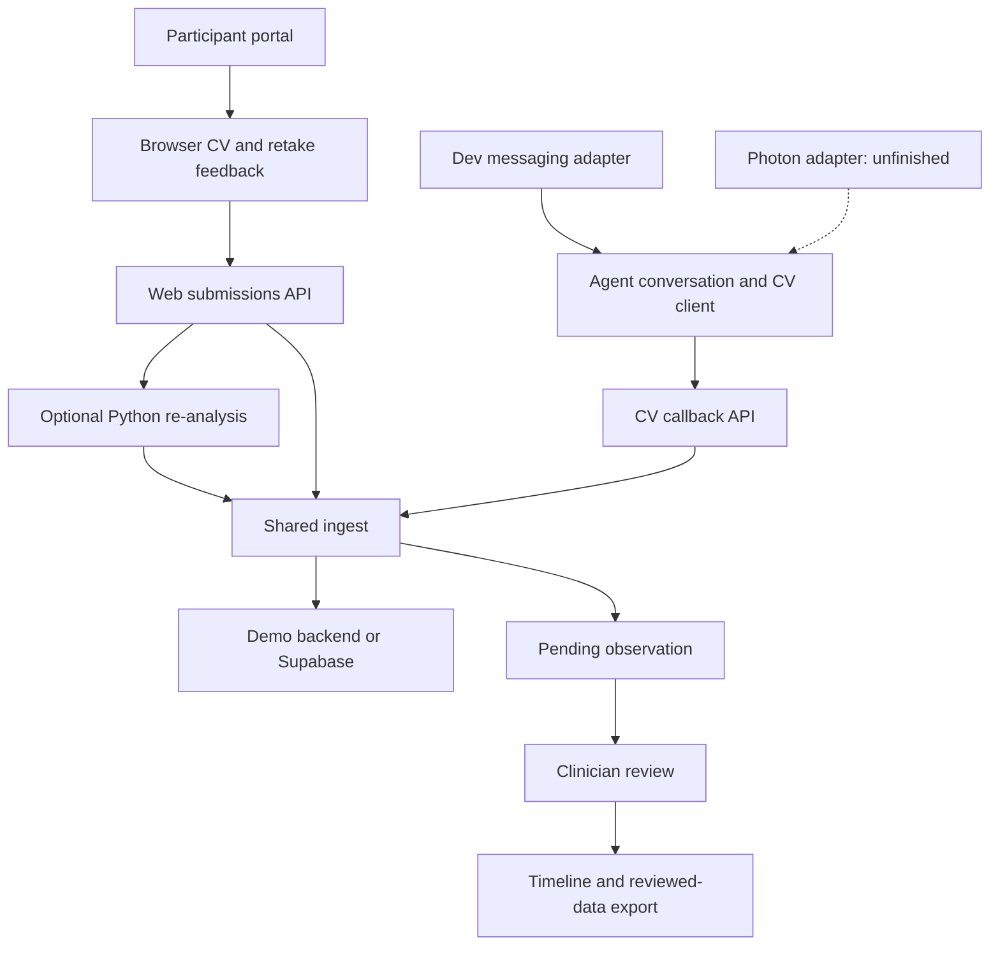

# Architecture and repository map

The Next.js web app contains both frontend screens and backend APIs. Browser CV is a client-side computation layer. Python CV and messaging run as separate services.

## Source structure

| Folder | Responsibility | Typical change |
|---|---|---|
| apps/web/app/participant/ | Participant screens | Capture, history, rewards |
| apps/web/app/researcher/ | Researcher screens | Review, timeline, study views |
| apps/web/app/api/ | Web backend endpoints | Submissions, review, export, models |
| apps/web/lib/ | Orchestration/helpers | Sessions, persistence, media, ingest |
| packages/cv/ | Browser CV algorithms | Local quality checks/features |
| packages/shared/ | Contracts/domain rules | Schemas, protocols, models, rewards |
| services/cv/ | Python reference analysis | Quality gates/measurements |
| services/agent/ | Messaging service | Adapters, conversation, reminders |
| supabase/ | Database migrations/seed | Schema/policies/demo records |
| training/ | Offline training/evaluation | Specs, metrics, model cards |
| adroit/ | Optional batch training | Dataset/cluster jobs |
| .github/ | CI | Tests |

Use these existing boundaries rather than moving code into generic frontend/backend folders.

## Capture flow

Failed attempts are logged. Usable captures can create pending observations and simulated rewards before clinician adjudication.

## Boundaries

- Browser CV provides fast capture feedback.
- When original media is available and Python analysis succeeds, the server result is recorded. The submissions handler can fall back to browser output on failure. Poster-only and failed-attempt paths skip re-analysis.
- Supabase is optional in demo mode. In-memory data/media are not durable across restarts or independent instances.
- Current cookie/default participant and “Demo clinician” identities are placeholders.
- Reviewing an observation changes its review state; it does not validate the model scientifically.
- Offline model generation is separate from a participant's live capture.

## Contracts and ownership

TypeScript contracts: [schemas.ts](../../packages/shared/src/schemas.ts). Python contracts: [models.py](../../services/cv/app/models.py). Coordinate changes to both and affected callers.

Keep reward policy in packages/shared, persistence/ingest in web server code, transport in agent adapters, and analysis in CV modules. Record completion evidence in the [roadmap](../delivery/ROADMAP.md).

[Frontend](FRONTEND.md) · [Backend](BACKEND.md) · [Feature inventory](../product/FEATURES.md)
